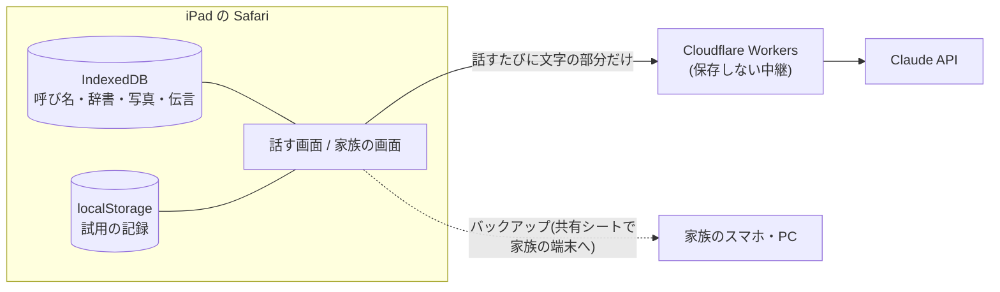

# リンちゃん ― わすれても、だいじょうぶ

Built with Claude: Japan 2026 の作品です。
企画は事前に検討し、コードはすべて 2026-11-02 12:00(JST)以降に作成しています。

認知症の高齢者が、忘れても、言葉が出なくても困らないように、家族が「記憶の代わり」を用意しておける iPad 向けの Web アプリです。本人は黒い犬の「リンちゃん」に話しかけるだけ。家族は写真と短い説明を登録しておくだけです。

作者の家族の困りごとから生まれました。本人と家族の間の「伝わらない」を、両方向から減らします。

- 家族の言葉が本人に伝わらない(何度も聞き返す)
- 本人の言いたいことが家族に伝わらない(「あれ」「あの」が増える、言葉の取り違え)

> 医療アドバイスや診断はしません。家族の代わりではなく、家族の関わりを増やす道具として作っています。

## できること

| 本人の画面(`/`) | 内容 |
|---|---|
| **声で聞くと、写真つきでゆっくり答える** | 「眼鏡はどこ?」→ 家族が登録した説明だけを根拠に答え、**部屋の写真に赤い丸**で置き場所を見せる。最初に必ず呼び名で呼びかけ、話し終わったらそのまま返事を聞き取る |
| **「あれ」から写真で選んで伝える** | 「ほら、あれ、歯にはさまったのを取る…」→ 会話・時間帯・登録から候補を推測し、写真2〜3枚で「これですか?」。外れたら「物・人・場所」の大きな3ボタン |
| **聞き返しへの言い直し** | 1回目は短く区切ってゆっくり、2回目は一言にして大きな文字で、3回目は「大丈夫ですよ。あとで一緒に見ましょうね」とやさしく終える |
| **リンちゃんから話しかける** | デイサービスの日の帰宅後に「おかえりなさい」と場所の写真で声をかける。会話がないときは、家族が登録した思い出の話題をきっかけにする |
| **家族からの伝言** | 家族が自分の声で録音した伝言、または **LINE で送った声や文字**を、本人が押したときに流す(文字はリンちゃんが読み上げる)。聞いたあとの返事を残し、家族に伝える(リンちゃんが家族の声で話すことはしない) |
| **ご家族が伝える** | そばの家族が話した言葉(「これ食べなさい、体にいいから」)を、意味は変えずに短く・やわらかく言い直し(「これ、体にいいですから、ひとくち食べませんか」)、要点を大きな文字と写真で見せる |
| **リンちゃん、代わって** | 同じ話が続いて家族が疲れたときに押すと、リンちゃんが思い出や写真の話題で話し相手を引き取る。家族が押したことや、その前のやり取りには触れず、記録にも残さない |
| **呼びかけモード(家族がオンにしたときだけ)** | 押さなくても「リンちゃん」と呼ぶと話を聞く。「あれどこかしら」と聞こえたら、声は出さずに写真だけ見せる。当てはまらない言葉は保存も送信もしない |
| **置きっぱなしで使える** | テレビや周りの声、画面の文字を読み上げた声には返事をしない。画面を消さず、日付・時刻・デイサービスの日を出す |

| 家族の画面 | 内容 |
|---|---|
| **家族の登録(`/family`、PIN つき)** | 呼び名、本人の言い方の辞書、物・人・場所の写真と説明、**物の置き場所(部屋の写真を押すだけ)**、思い出の話題、デイサービスの日、声の伝言、リンちゃんの声の速さ・高さ、バックアップ |
| **言葉の辞書の候補** | 「言った言葉 → 写真で選んだもの」の記録から、本人独特の言い方(例:ズック=運動靴)や言葉の取り違え(例:熱いのに「冷たい」)を Claude が見つけ、家族が確認して辞書に足す |
| **試用の記録(`/log`)** | 会話、聞き返しの回数、写真で選べたか、話しかけへの反応、**同じ質問のくり返し**。家族が「伝わった/伝わらなかった」の印とメモを付けられる |
| **家族への報告(LINE)** | 今日の記録を Claude がまとめ、「本人が話したこと」と「記録で確かめられたこと」を分けて書く。家族が読んで直してから LINE に送る。伝言への本人の返事は、その場で LINE に知らせる |
| **音声の確認(`/check`)** | iPad の Safari で音声認識と読み上げが動くか、止まるときの原因の記録 |

## Claude の使い方

| 場面 | API | モデル | 工夫 |
|---|---|---|---|
| 本人との会話 | `/api/talk` | `claude-haiku-5-5` | 返事の速さを優先(1秒前後)。訂正しない・推測しない・診断しない・同じ質問に同じ調子で答える、をシステムプロンプトで徹底。時刻と聞き返しの段階は会話の末尾の system メッセージで渡す |
| 「あれ」の推測 | `/api/guess` | `claude-haiku-5-5` | Structured Outputs(zod)で「種類」と「候補の名前」だけを返させ、登録にない名前は捨てる |
| 家族の言葉の言い直し | `/api/relay` | `claude-haiku-5-5` | 意味は変えず、命令や責める言い方をやわらげる。本人の言い方の辞書を使い、「それ」は直前の会話ではっきり分かるときだけ置きかえる |
| テレビの音の判定 | `/api/talk` の中 | `claude-haiku-5-5` | 呼び出しを増やさず、会話のプロンプトの中で「本人への言葉でない」ときだけ印を返させ、画面は返事をしない |
| 言葉の辞書の候補 | `/api/dictionary` | `claude-sonnet-5-5` | 記録の読み解きは Sonnet。Structured Outputs で根拠つきの候補を返し、断られたときはサーバー側のフォールバック(`fallbacks: "default"`)でやり直す |
| 今日のメモ | `/api/digest` | `claude-sonnet-5-5` | 30分話さず会話が区切れたら、本人の話・家族から・聞かれたことに分けて短くまとめる。本人の話は事実として扱わず、「さっき」と持ち出さない |
| 家族への報告 | `/api/report` | `claude-sonnet-5-5` | 本人の話と記録上の事実を分けて要約。診断・評価・助言は書かない。送るのは家族が確認した文だけ |

### 返事の質のテスト

`npm run eval` で、架空のサンプルを使って決まった質問を送り、方針を守れているかを自動で確かめます(開発サーバーを起動した状態で実行。公開先は `npm run eval -- https://...`)。

- 登録にあることに答える / 同じ質問に同じ調子で答える / 登録にないことは推測せず家族に聞くよう返す
- 本人の言い方を理解する / 勘違いや思い出の食い違いを訂正しない / 体の具合や薬を判断しない
- 聞き返しの段階ごとに短くなる / 「さっきも」と言わない / 仕組みの話をしない / 読み上げに向かない記号を使わない
- 「あれ」から正しい候補を推測できる
- テレビの天気予報や通販の声には返事をせず、本人の独り言や言いかけには返事をする
- 置き場所が登録されていない物は推測しない / 記憶を試す質問をしない / 忘れたと言われたら思い出させない

開発そのものも Claude Code と一緒に進めています(`CLAUDE.md` に方針、コミット履歴に経過)。

## 試用から学んで直したこと

実際に家族と試用し(11/4)、記録(`/log`)と付き添いの家族のメモ(試用ノート)をもとに直しました。

| 試用で起きたこと | 直したこと |
|---|---|
| 画面の「止める」「お話しください」を本人が読み上げ、リンちゃんがそれに返事をしてしまった | 画面から指示の文字をなくし、ボタンを絵にした。画面の文字を読んだだけの声には返事をしない |
| 「どんな番組でしたか」→「忘れました」→「思い出してみましょう」と、記憶を試す流れになった | 記憶を試す質問・何でも答えられる質問をしない。忘れたら「大丈夫ですよ」で終える。返事のテストに足した |
| 置き場所が登録されていない物を「引き出しにあるかもしれません」と推測した | 置き場所が書いていない物は推測せず、家族に聞くよう返す。「かもしれません」で答えない |
| 話しかけられたことに気づくのが遅く、後半だけ聞いていた | 最初に必ず呼び名で呼びかけ、間をあけてから本題を話す |
| 毎回ボタンを押すのが難しく、伝言に返事をしようとして押す前に話していた | リンちゃんが話し終わったら・伝言を聞き終わったら、そのまま返事を聞き取る |
| 伝言のカードがずっと出ていて、何度も押していた | 返事をするか「わかった」で閉じる。字幕を出し、返事は家族の画面に残す |
| 家族の言葉が「今の」「ちょうどいいよ」と途中で切れた | 家族の聞き取りは、間があいても2.5秒黙るまで続けて聞く |
| 物の置き場所を写真で示す欄が見つからなかった | 物の登録を「名前 → 写真 → どこにありますか? → 説明」の手順にし、部屋の写真もその場で撮れるようにした |

## プライバシーの設計

公開リポジトリで、扱うのは家族の写真や会話なので、**家族の情報はサーバーに置かない**設計にしています。



- 写真・声の伝言・試用の記録は iPad の中だけ。写真は Claude に送らない
- LINE への報告は、家族が内容を確認して「送る」を押したときだけ送り、サーバーには残さない
- サーバーは受け取った文字を Claude に渡すだけで、何も保存しない。API キーは wrangler の secret
- 例外は **LINE から届いた伝言** だけ。iPad が取りに来るまで Cloudflare KV に置き、受け取ったらすぐ消す。受け取られなくても3日で消える(LINE の Webhook は iPad に直接届かないため)
- バックアップは1つのファイルに書き出し、家族が自分の端末に保存する
- リポジトリには架空のサンプル(`samples/`)とイラストだけを置く

## 動かし方

```bash
npm install
echo 'ANTHROPIC_API_KEY=sk-ant-...' > .dev.vars   # git には入りません
npm run dev                                         # http://localhost:3000
```

Cloudflare Workers(OpenNext)に置くとき:

```bash
npx wrangler secret put ANTHROPIC_API_KEY
npm run deploy
```

- API キーは `.env*` ではなく `.dev.vars` に置きます(OpenNext は `.env*` をビルドに含めるため)
- LINE に報告を送るときは、LINE Developers で Messaging API のチャネル(公式アカウント)を作り、チャネルアクセストークンを secret に入れます。入れていなければ、報告は画面でコピーするだけになります

```bash
npx wrangler secret put LINE_CHANNEL_ACCESS_TOKEN   # チャネルアクセストークン(長期)
npx wrangler secret put LINE_TO                     # (任意)送り先のユーザー ID。入れなければ、友だち追加した全員に送る
npx wrangler secret put RIN_APP_KEY                 # 合言葉。iPad の家族の登録画面にも同じものを入れる
npx wrangler secret put LINE_CHANNEL_SECRET         # (LINE から伝言を送るとき)チャネルシークレット
```
- LINE への送信は、合言葉(`RIN_APP_KEY`)が合うときだけ行います。URL を知っている人が勝手に家族へ送れないようにするためです
- LINE から伝言を送るには、LINE Developers の Messaging API 設定で Webhook URL を `https://<あなたのドメイン>/api/line/webhook` にして「Webhook の利用」をオンにし、LINE Official Account Manager の応答設定で「応答メッセージ」をオフにします。KV は `npx wrangler kv namespace create rin-inbox` で作り、`wrangler.jsonc` の `RIN_INBOX` に ID を入れます。届いた伝言は、iPad が1分ごとに合言葉つきで取りに行きます
- 家族の登録がないときは `samples/profile.json` の架空のデータで答えます

## iPad で使うときの注意

- **Safari のまま使ってください。** ホーム画面に追加した Web アプリでは、iOS の制限で音声認識が動きません
- 画面収録をマイクつきで行うと、マイクを取り合って聞き取りが止まります
- iPad の Safari で使える日本語の声は1種類です(設定でダウンロードした声は Safari から使えません)。家族の登録で速さと高さを調整します
- リンちゃんを2秒長押し(または右下の「家族の方へ」)で家族の登録画面が開きます

## 技術構成

Next.js 16(App Router)/ React 19 / Tailwind CSS 4 / Web Speech API(音声認識・読み上げ)/ IndexedDB / Cloudflare Workers(OpenNext)/ Anthropic TypeScript SDK

```
app/
  page.tsx            本人の画面(Talk)
  family/             家族の登録(PIN つき)
  log/                試用の記録
  check/              音声の確認
  api/talk            会話(Haiku)
  api/guess           「あれ」の推測(Haiku + Structured Outputs)
  api/dictionary      言葉の辞書の候補(Sonnet + Structured Outputs)
  replay              デモ動画の撮影用。架空の台本(samples/replay.json)を話す画面で再生する。Claude は呼ばない
  api/report          家族への報告(Sonnet)と LINE への送信
  api/notify          伝言への返事を LINE に知らせる
  api/digest          会話の区切りで、今日これまでの話をメモにする(Sonnet。メモは iPad にだけ残す)
  api/line/webhook    LINE から届いた伝言を一時的に置く(署名を確かめる)
  api/inbox           iPad が LINE からの伝言を取りに来る(合言葉つき、受け取ったら消す)
  api/relay           家族の言葉の言い直し(Haiku + Structured Outputs)
  lib/prompt.ts       リンちゃんの話し方(システムプロンプト)
  lib/familyStore.ts  iPad の中の保存とバックアップ
  lib/conversation.ts 会話の流れ(30分空いたら新しい会話)
scripts/eval-talk.mjs 返事の質のテスト
samples/profile.json  公開用の架空データ
```
